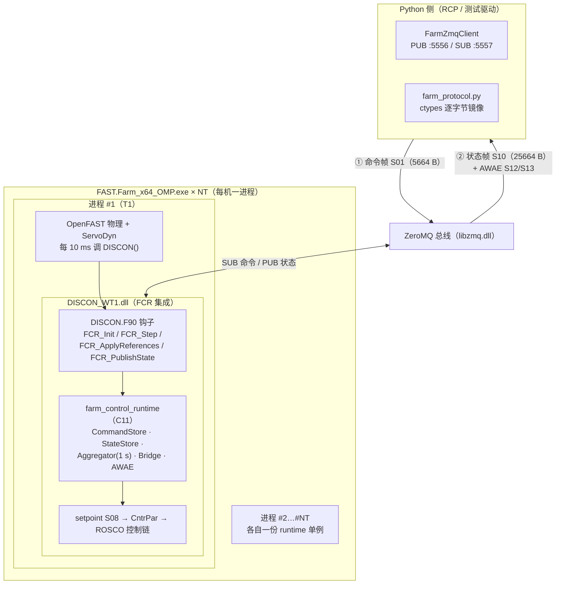
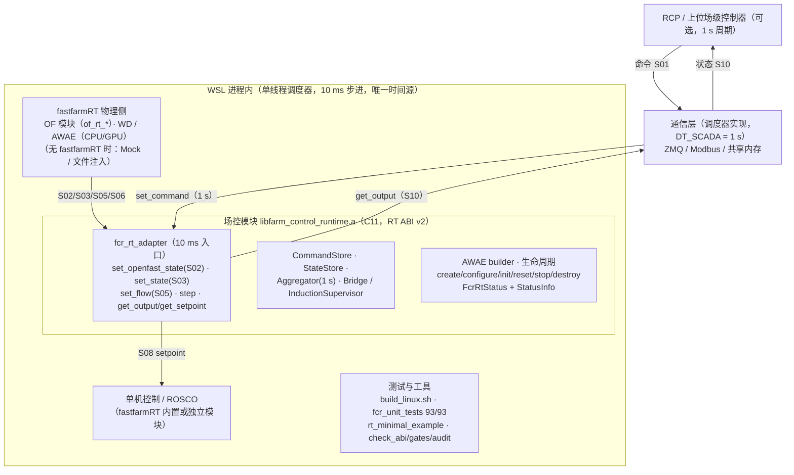

# 场控模块架构图（Windows 运行态 / WSL 部署态）

> 配套：`00_DELIVERY_NOTE_RT_INTEGRATION.md`、`01_WSL_FASTFARMRT_INTEGRATION.md`、`02_WSL_DEPLOY_AND_TEST_GUIDE.md`、`03_RT_DATA_AND_TIME_POLICY.md`
> 图片：`figures/arch_windows_runtime.png|.svg`、`figures/arch_wsl_deploy.png|.svg`

---

## 图 1  Windows 离线闭环运行架构


**要点**：FAST.Farm 每台风机**一个独立进程**；场控 runtime（C11）与 ROSCO（Fortran）
**静态链接进同一个 `DISCON_WT1.dll`**；Python RCP 通过 ZMQ 与该 DLL 内的 transport 通信。



**调用链（10 ms，进程内）**

```
ServoDyn → DISCON(avrSWAP,...)
  ├─ FCR_Init(tid) / FCR_ProviderInit()            （首次）
  ├─ FCR_Step(tid, t)
  │    └─ ZMQ 命令拉取 → CommandStore（seq/TTL/control_enable/偏航锁存）
  │       → 生成 setpoint（bridge core 或 InductionSupervisor）→ rt->setpoint[tid]
  ├─ FCR_ApplyReferences(CntrPar)                   → PRC/PS/VS 注入
  ├─ [ROSCO 官方控制链]（YawRateControl 内含外部偏航目标钩子）
  └─ FCR_PublishState / FCR_PublishExtra            → StateStore（1 s 后聚合为 S10）
```

**产物与验收**：`DISCON_WT1.dll`（2369.7 KB）、`libzmq.dll`、`check_abi.py`（82 字段偏移）、
`audit_signals.py`（88/88）、单元测试 100/100。

---

## 图 2  WSL + fastfarmRT 部署架构


**要点**：WSL 内**不使用** Windows DLL；物理侧由 **fastfarmRT** 提供 OF / WD / AWAE（CPU/GPU）；
场控模块以**静态库**形式被调度器每 10 ms 调用；**传输由调度器负责**（模块不持有 socket）；
仅 RT 框架与实时指标属采购后 M4。



**调用序列**

```
create → configure → init
  每 10 ms : set_openfast_state(S02) / set_state(S03) → step(RTimeCtx) → 返回值/StatusInfo 判 D0~D4
  每 1 s  : set_flow(S05) / set_command(S01) / get_output(S10) / get_awae(S12/S13)
  reset（run→reset→run 可重复）→ stop → destroy
```

**WSL 中可执行**：`tools/build_linux.sh`（cmake 或 `--gcc` 兜底）、`fcr_unit_tests`（93/93）、
`examples/rt_minimal_example`、`check_abi.py` / `check_icd_gates.py` / `audit_signals.py`，
以及基于 **fastfarmRT** 的 6T 物理闭环（M3）。

**WSL 中不使用**：`DISCON_WT1.dll`（Windows PE）、Windows 版 ZMQ/Modbus 传输。

---

## 两图差异对照

| 维度 | Windows 运行态（图 1） | WSL + fastfarmRT（图 2） |
|---|---|---|
| 进程模型 | FAST.Farm 每机一进程 + Python 控制进程 | 单进程（调度器）+ 以后可拆 |
| 场控模块形态 | 静态链接进 `DISCON_WT1.dll` | 静态库 `libfarm_control_runtime.a` |
| 谁驱动 10 ms | ServoDyn 调 `DISCON()` | 调度器调 `fcr_rt_step()` |
| 时间来源 | FAST.Farm 仿真时间（`sim_time_s` 传入） | 调度器 `FcrRtTimeCtx`（唯一权威） |
| 传输 | DLL 内 ZMQ（SUB/PUB，libzmq.dll） | 调度器负责（模块不持有 socket） |
| 外部接口 | ZMQ 帧（S01/S10/S12/S13） | `set_*` / `get_*` 函数调用 |
| 状态输入 | avrSWAP 单结构（S02+S03 合并） | **S02（OF）与 S03（ROSCO）分离**，字段级合并 |
| 单机控制 | 同进程 ROSCO（Fortran） | fastfarmRT 内置或独立模块；S08 经 C 接口交付 |
| 物理模型 | FAST.Farm + OpenFAST | **fastfarmRT（OF/WD/AWAE，CPU/GPU）** |
| 线程/锁 | OpenMP 多线程 + `CRITICAL_SECTION` | 单线程约定；RT 路径无锁 |
